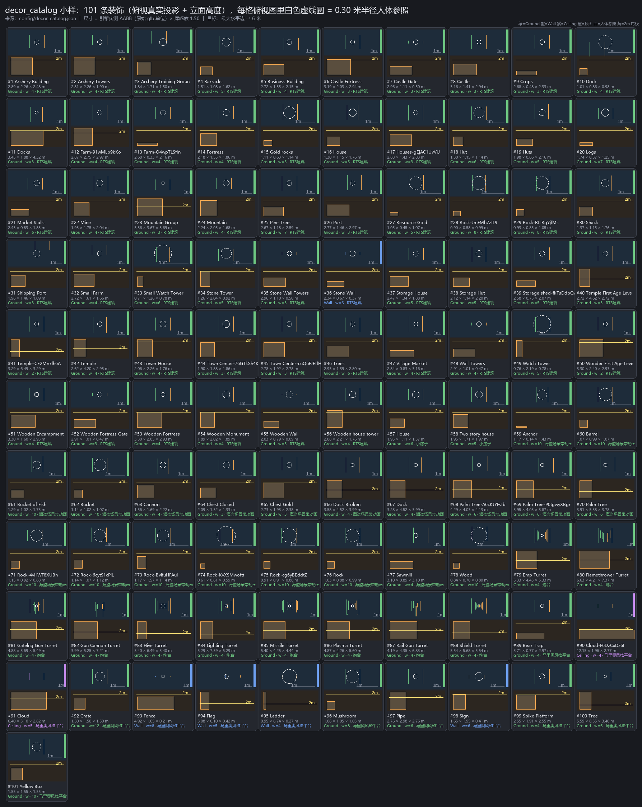

# 素材装饰目录（decor_catalog.json）

> **自动生成**：由 `tools/decor_catalog/build_catalog.py --md` 从 `config/decor_catalog.json` 重写；
> 不要手改本文件的统计表。收录策略（哪张图算装饰、什么层、权重）在 `tools/decor_catalog/rules.py`。

## 1. 一句话

`素材/` 下 **301** 个 `.glb` 经量测 + 收录规则，筛出 **101** 个适合做房间装饰，按 `DecorArchetypeId` 顺序编号写进
`config/decor_catalog.json`；每条带**真实包围盒**（原始单位 + 逻辑米）与摆放属性（层/权重/类别掩码/间距/缩放区间）。
宿主侧 `DungeonSceneBuilder` 只需读这份 JSON，把 `DecorPlacement.Archetype.Value` 映射到 `path` 与最终缩放。

## 2. 收录统计

| 项 | 数量 |
|---|---|
| 源 `.glb` 文件 | 301 |
| **收录（items）** | **101** |
| 跳过（skipped，含原因） | 200 |
| 量测失败（measureErrors） | 0 |

**按摆放层**

| 层 | 条数 | 说明 |
|---|---|---|
| `Ground` | 94 | 落地：箱/桶/岩石/树/帐篷/房屋/炮台 —— 占地面，需要避让刷怪点与门 |
| `Wall` | 5 | 贴墙：墙段/栅栏/标牌/旗帜/梯子 —— 必须 `AgainstWall`，沿墙面朝向 |
| `Ceiling` | 2 | 吊顶：云朵等高空挂件 —— 俯视时从相机方向掠过，不占地面 |

**按素材目录**（收录 / 跳过）

| 素材目录 | 收录 | 跳过 |
|---|---|---|
| RTS建筑 | 56 | 49 |
| 小房子 | 2 | 6 |
| 海盗场景带动画 | 20 | 51 |
| 炮台 | 10 | 0 |
| 马里奥风格平台 | 13 | 10 |
| RPG武器 | 0 | 55 |
| 卡通人物带全套动画 | 0 | 4 |
| 枪械 | 0 | 25 |

**按房间类别**（一条装饰可属于多个类别；数量 = 该类房间可抽取的候选数）

| 类别 | 候选数 | 语义 |
|---|---|---|
| `Start` | 55 | 起始房（玩家出生，无怪） |
| `Combat` | 80 | 战斗房 |
| `Special` | 65 | 特殊房（商店/铁匠/奖励） |
| `Hidden` | 43 | 隐藏房 |
| `Prototype` | 22 | 原型测试房（只出机关） |
| `Boss` | 73 | Boss 房 |
| `Safe` | 57 | 安全房（存档/教学） |

## 3. 测量方法与可信度

**方法 A（生成时，纯标准库）**：直读 GLB 的 JSON chunk（12 字节头 `glTF` + version + length，随后 chunk 序列）：

1. 每个 `mesh.primitive.attributes.POSITION` 指向的 accessor **强制带 `min`/`max`**（glTF 2.0 规范），
   取并集 = 该 mesh 的局部包围盒；
2. 对每个引用 mesh 的 node，按 `translation` / `rotation`(四元数) / `scale` 把局部盒 8 角点变换到世界系
   （有 `matrix` 的 node 直接做 4×4 乘法）；带 `children` 的节点只按「子节点自身 TRS」（素材全是 FBX2glTF 单层平铺结构，实测足够）；
3. 所有 mesh node 世界盒的并集 = 场景轴对齐包围盒；尺寸取 `max - min`，**保留 6 位小数**。
   **不读 BIN chunk**：代价是旋转件按「变换后的局部盒」包围（略偏大，旋转 45° 时误差上限 √3），速度是 O(accessor 数)。

**方法 B（交叉验证，headless Godot）**：`tools/decor_catalog/measure_with_godot.gd` 在
`--headless --path . --script` 下用 `ResourceLoader` 加载**同一批 glb**，取每个 `MeshInstance3D` 的 `Mesh.get_aabb()`
经世界变换求并集。结果：

| 校验项 | 结果 |
|---|---|
| 加载成功 / 失败 | 101 / 0 |
| 已核对条数 | 101 |
| **两种方法最大偏差（原始单位）** | **0.0001 m** |

> 结论：JSON 里的 `sizeRaw` 与引擎实际 AABB 在原始单位下逐轴一致（偏差 < 1e-4 m），
> 且引擎加载 101/101 无缺失。引擎加载时的「导入缩放」实测为 ×1（原始单位 = 渲染单位），见 §5。

## 4. 坐标与缩放口径（**宿主解释器按这个来**）

- `sizeRaw` = glb 原始单位下的轴对齐包围盒尺寸（方法 A 直读，可追溯）；`sizeMeters` = `sizeRaw × assetLibraryScale`（当前 1.5）。
- `assetLibraryScale` 存在的原因：素材分包商各用一套单位（RPG 武器 1 单位≈1 米；海盗场景 1 单位≈10 米；炮台 1 单位≈0.5 米）。
  归一化后「实体件」逻辑尺寸 ~0.85 米高、「户型件」~1.3 米，才对得上 1000 m/s 级弹速与 12 米一格的房间尺度。
- **缩放基准 `logical-horizontal`**：`placement.Scale = 1` ⇔ 该模型最大水平边（`max(sizeMeters.x, sizeMeters.z)`）≈ **6.0 米**。
  宿主公式：`finalScale = placement.Scale × targetMaxHorizontalMeters / max(sizeMeters.x, sizeMeters.z) × GodotImportScale`。
- 每条另有 `fitScaleToTarget`（= 把该条压到 6 米的系数，已折进库缩放），宿主若想跳过除法可直接乘它。
- 目标区间 `targetMaxHorizontalRange` = [3.0, 6.0]：落在这个区间内的装饰最大水平边 3~6 米（≈ 半格），
  规划器给出的 `scaleMin/scaleMax` 就是围绕 1 的抖动区间，所以不同素材目录的模型可以共用同一套区间。
- 轴向：glTF 右手系 Y 上；Godot 也是 Y 上，**无需换轴**（实测包围盒逐轴一致）。`sizeMeters[1]` = 贴地摆放时的实际高度；
  `meshHeightMeters` 同值，单独给「检查是否高过墙」用。

## 5. 引擎实测：导入缩放与加载

- 101/101 个 glb 可被 `ResourceLoader` 直接 `load()` 成 `PackedScene` 并 `instantiate()` 成 `Node3D`；
  **导入缩放 = ×1**（`Barrel.glb` 原始 0.715/0.660/0.715 m → 引擎 AABB 0.715/0.660/0.715 m）。
  因此「逻辑米」到「渲染米」只差本目录的 `assetLibraryScale`，宿主最终缩放见 §4。
- 每个模型实例化后只有 **1 个 `MeshInstance3D`**（复合件也已在导出时合并），没有需要额外遍历的骨骼节点。
- `needsAssetImport` 恒为 `true`：`.glb.import` 随工程提交，运行时用 `res://素材/...glb` 直接加载；
  若某条在目标机器上缺 `.import`，Godot 会把它当普通文件报 `ResourceLoader.exists = false`，避免静默丢装饰。
- 测量产物 `tmp/decor_catalog/godot_measured.json` 是**一次性的核对结果**（本工程无 .git 仓库，`.gitignore` 暂无 `tmp/` 条目；
  若将来入库，请把该产物加进 `.gitignore`——它可由本探针随时重建）。JSON 里已并入 `engineSizeRaw` / `engineChecked`，
  所以删掉 `tmp/` 也不影响宿主使用目录。
- 运行探针命令（只读，产物在 `tmp/`，不入库）：

```powershell
& "E:\Godot\Godot_v4.7.2-stable_mono_win64_console.exe" --headless --path . `
    --script tools/decor_catalog/measure_with_godot.gd
```

## 6. 跳过了什么、为什么

| 类别 | 条数 | 原因 |
|---|---|---|
| RPG武器：拾取物 / 装备外观，不是房间静态装饰 | 55 |  |
| 同款贴图 / 同几何的变体（只留一张） | 25 |  |
| 枪械：拾取物 / 装备外观，不是房间静态装饰 | 25 |  |
| 小件 / 图标（俯视不可辨或属于拾取物） | 21 |  |
| 尺寸过大（单件超过房间尺度，或与已收录同款重复） | 11 |  |
| 手持武器（角色装备外观） | 11 |  |
| 带骨骼动画的人物/动物（改走角色素材管线） | 8 |  |
| House：变体（只留一张） | 5 |  |
| Two story house：变体（只留一张） | 5 |  |
| Barracks：变体（只留一张） | 4 |  |
| 卡通人物带全套动画：角色，不是装饰（改走角色素材管线） | 4 |  |
| 属于玩法道具 / 贴花，不是装饰 | 3 |  |
| Hut：变体（只留一张） | 2 |  |
| 碎石小件（俯视不可辨） | 2 |  |
| Temple：同款变体（只留一张） | 2 |  |
| Watch Tower：变体（只留一张） | 2 |  |
| 薄片贴地块（没有立体轮廓） | 1 | 地面贴地块（0.06 米厚），没有立体轮廓 |
| Houses：变体（只留一张） | 1 | Houses 变体 |
| 与 Market Stalls.glb 重复的紧凑变体 | 1 | 与 Market Stalls.glb 重复的紧凑变体 |
| Shack：变体（只留一张） | 1 | Shack 变体 |
| Stone Tower：变体（只留一张） | 1 | Stone Tower 变体 |
| 只有地基（0.3 米高），不是完整建筑 | 1 | 只有地基（0.3 米高），不是完整建筑 |
| 低矮地面件，俯视辨识度低 | 1 | 被砍倒的树，低矮地面件，俯视辨识度低 |
| 与 Stone Wall Towers 重复的门楼变体 | 1 | 与 Stone Wall Towers 重复的门楼变体 |
| Windmill.glb：变体（只留一张） | 1 | Windmill.glb 变体 |
| 体积/轮廓会穿模 | 1 | 风车旋翼外扩，Boss 房全景视角会穿模 |
| House.glb：变体（只留一张） | 1 | House.glb 变体 |
| 动物（非场景装饰） | 1 | 动物（非场景装饰） |
| 细杆件（作为装饰太单薄） | 1 | 3 米细杆，作为装饰太单薄 |
| 5 米级船，属于载具玩法，不是装饰 | 1 | 5 米级船，属于载具玩法，不是装饰 |
| 动画触手，尺寸 19 米级、不属于房间静态装饰 | 1 | 动画触手，尺寸 19 米级、不属于房间静态装饰 |

<details><summary>逐条跳过清单（200 条）</summary>

| res:// 路径 | 原因 |
|---|---|
| `res://素材/RPG武器/Armor Golden.glb` | 武器/护甲/珠宝/书卷类：属于拾取物或装备外观，不是房间静态装饰。个别可用作货架摆件（Shield/Book/Chalice）已作为**货架陈列**在 docs 里登记，未进 v1 目录。 |
| `res://素材/RPG武器/Armor Leather.glb` | 武器/护甲/珠宝/书卷类：属于拾取物或装备外观，不是房间静态装饰。个别可用作货架摆件（Shield/Book/Chalice）已作为**货架陈列**在 docs 里登记，未进 v1 目录。 |
| `res://素材/RPG武器/Armor Metal.glb` | 武器/护甲/珠宝/书卷类：属于拾取物或装备外观，不是房间静态装饰。个别可用作货架摆件（Shield/Book/Chalice）已作为**货架陈列**在 docs 里登记，未进 v1 目录。 |
| `res://素材/RPG武器/Arrow.glb` | 武器/护甲/珠宝/书卷类：属于拾取物或装备外观，不是房间静态装饰。个别可用作货架摆件（Shield/Book/Chalice）已作为**货架陈列**在 docs 里登记，未进 v1 目录。 |
| `res://素材/RPG武器/Axe Double.glb` | 武器/护甲/珠宝/书卷类：属于拾取物或装备外观，不是房间静态装饰。个别可用作货架摆件（Shield/Book/Chalice）已作为**货架陈列**在 docs 里登记，未进 v1 目录。 |
| `res://素材/RPG武器/Axe Small.glb` | 武器/护甲/珠宝/书卷类：属于拾取物或装备外观，不是房间静态装饰。个别可用作货架摆件（Shield/Book/Chalice）已作为**货架陈列**在 docs 里登记，未进 v1 目录。 |
| `res://素材/RPG武器/Backpack.glb` | 武器/护甲/珠宝/书卷类：属于拾取物或装备外观，不是房间静态装饰。个别可用作货架摆件（Shield/Book/Chalice）已作为**货架陈列**在 docs 里登记，未进 v1 目录。 |
| `res://素材/RPG武器/Bag.glb` | 武器/护甲/珠宝/书卷类：属于拾取物或装备外观，不是房间静态装饰。个别可用作货架摆件（Shield/Book/Chalice）已作为**货架陈列**在 docs 里登记，未进 v1 目录。 |
| `res://素材/RPG武器/Bone.glb` | 武器/护甲/珠宝/书卷类：属于拾取物或装备外观，不是房间静态装饰。个别可用作货架摆件（Shield/Book/Chalice）已作为**货架陈列**在 docs 里登记，未进 v1 目录。 |
| `res://素材/RPG武器/Book Open.glb` | 武器/护甲/珠宝/书卷类：属于拾取物或装备外观，不是房间静态装饰。个别可用作货架摆件（Shield/Book/Chalice）已作为**货架陈列**在 docs 里登记，未进 v1 目录。 |
| `res://素材/RPG武器/Book-LC0w7VI75u.glb` | 武器/护甲/珠宝/书卷类：属于拾取物或装备外观，不是房间静态装饰。个别可用作货架摆件（Shield/Book/Chalice）已作为**货架陈列**在 docs 里登记，未进 v1 目录。 |
| `res://素材/RPG武器/Book-h3Wh4fxSQX.glb` | 武器/护甲/珠宝/书卷类：属于拾取物或装备外观，不是房间静态装饰。个别可用作货架摆件（Shield/Book/Chalice）已作为**货架陈列**在 docs 里登记，未进 v1 目录。 |
| `res://素材/RPG武器/Book.glb` | 武器/护甲/珠宝/书卷类：属于拾取物或装备外观，不是房间静态装饰。个别可用作货架摆件（Shield/Book/Chalice）已作为**货架陈列**在 docs 里登记，未进 v1 目录。 |
| `res://素材/RPG武器/Chalice.glb` | 武器/护甲/珠宝/书卷类：属于拾取物或装备外观，不是房间静态装饰。个别可用作货架摆件（Shield/Book/Chalice）已作为**货架陈列**在 docs 里登记，未进 v1 目录。 |
| `res://素材/RPG武器/Chest.glb` | 武器/护甲/珠宝/书卷类：属于拾取物或装备外观，不是房间静态装饰。个别可用作货架摆件（Shield/Book/Chalice）已作为**货架陈列**在 docs 里登记，未进 v1 目录。 |
| `res://素材/RPG武器/Claymore.glb` | 武器/护甲/珠宝/书卷类：属于拾取物或装备外观，不是房间静态装饰。个别可用作货架摆件（Shield/Book/Chalice）已作为**货架陈列**在 docs 里登记，未进 v1 目录。 |
| `res://素材/RPG武器/Coin Pouch.glb` | 武器/护甲/珠宝/书卷类：属于拾取物或装备外观，不是房间静态装饰。个别可用作货架摆件（Shield/Book/Chalice）已作为**货架陈列**在 docs 里登记，未进 v1 目录。 |
| `res://素材/RPG武器/Coin.glb` | 武器/护甲/珠宝/书卷类：属于拾取物或装备外观，不是房间静态装饰。个别可用作货架摆件（Shield/Book/Chalice）已作为**货架陈列**在 docs 里登记，未进 v1 目录。 |
| `res://素材/RPG武器/Crown.glb` | 武器/护甲/珠宝/书卷类：属于拾取物或装备外观，不是房间静态装饰。个别可用作货架摆件（Shield/Book/Chalice）已作为**货架陈列**在 docs 里登记，未进 v1 目录。 |
| `res://素材/RPG武器/Dagger.glb` | 武器/护甲/珠宝/书卷类：属于拾取物或装备外观，不是房间静态装饰。个别可用作货架摆件（Shield/Book/Chalice）已作为**货架陈列**在 docs 里登记，未进 v1 目录。 |
| `res://素材/RPG武器/Doublesided Hammer.glb` | 武器/护甲/珠宝/书卷类：属于拾取物或装备外观，不是房间静态装饰。个别可用作货架摆件（Shield/Book/Chalice）已作为**货架陈列**在 docs 里登记，未进 v1 目录。 |
| `res://素材/RPG武器/Fish Bone.glb` | 武器/护甲/珠宝/书卷类：属于拾取物或装备外观，不是房间静态装饰。个别可用作货架摆件（Shield/Book/Chalice）已作为**货架陈列**在 docs 里登记，未进 v1 目录。 |
| `res://素材/RPG武器/Glove.glb` | 武器/护甲/珠宝/书卷类：属于拾取物或装备外观，不是房间静态装饰。个别可用作货架摆件（Shield/Book/Chalice）已作为**货架陈列**在 docs 里登记，未进 v1 目录。 |
| `res://素材/RPG武器/Gold Ingots.glb` | 武器/护甲/珠宝/书卷类：属于拾取物或装备外观，不是房间静态装饰。个别可用作货架摆件（Shield/Book/Chalice）已作为**货架陈列**在 docs 里登记，未进 v1 目录。 |
| `res://素材/RPG武器/Key-MUl40QpEvv.glb` | 武器/护甲/珠宝/书卷类：属于拾取物或装备外观，不是房间静态装饰。个别可用作货架摆件（Shield/Book/Chalice）已作为**货架陈列**在 docs 里登记，未进 v1 目录。 |
| `res://素材/RPG武器/Key-bg6e1lfNsO.glb` | 武器/护甲/珠宝/书卷类：属于拾取物或装备外观，不是房间静态装饰。个别可用作货架摆件（Shield/Book/Chalice）已作为**货架陈列**在 docs 里登记，未进 v1 目录。 |
| `res://素材/RPG武器/Key-h5nke04hRD.glb` | 武器/护甲/珠宝/书卷类：属于拾取物或装备外观，不是房间静态装饰。个别可用作货架摆件（Shield/Book/Chalice）已作为**货架陈列**在 docs 里登记，未进 v1 目录。 |
| `res://素材/RPG武器/Key.glb` | 武器/护甲/珠宝/书卷类：属于拾取物或装备外观，不是房间静态装饰。个别可用作货架摆件（Shield/Book/Chalice）已作为**货架陈列**在 docs 里登记，未进 v1 目录。 |
| `res://素材/RPG武器/Knife.glb` | 武器/护甲/珠宝/书卷类：属于拾取物或装备外观，不是房间静态装饰。个别可用作货架摆件（Shield/Book/Chalice）已作为**货架陈列**在 docs 里登记，未进 v1 目录。 |
| `res://素材/RPG武器/Mineral.glb` | 武器/护甲/珠宝/书卷类：属于拾取物或装备外观，不是房间静态装饰。个别可用作货架摆件（Shield/Book/Chalice）已作为**货架陈列**在 docs 里登记，未进 v1 目录。 |
| `res://素材/RPG武器/Necklace-Jvhs8DCNDZ.glb` | 武器/护甲/珠宝/书卷类：属于拾取物或装备外观，不是房间静态装饰。个别可用作货架摆件（Shield/Book/Chalice）已作为**货架陈列**在 docs 里登记，未进 v1 目录。 |
| `res://素材/RPG武器/Necklace.glb` | 武器/护甲/珠宝/书卷类：属于拾取物或装备外观，不是房间静态装饰。个别可用作货架摆件（Shield/Book/Chalice）已作为**货架陈列**在 docs 里登记，未进 v1 目录。 |
| `res://素材/RPG武器/Open Book-1A07aI9j2d.glb` | 武器/护甲/珠宝/书卷类：属于拾取物或装备外观，不是房间静态装饰。个别可用作货架摆件（Shield/Book/Chalice）已作为**货架陈列**在 docs 里登记，未进 v1 目录。 |
| `res://素材/RPG武器/Open Book-JEDMpG0UIR.glb` | 武器/护甲/珠宝/书卷类：属于拾取物或装备外观，不是房间静态装饰。个别可用作货架摆件（Shield/Book/Chalice）已作为**货架陈列**在 docs 里登记，未进 v1 目录。 |
| `res://素材/RPG武器/Open Book.glb` | 武器/护甲/珠宝/书卷类：属于拾取物或装备外观，不是房间静态装饰。个别可用作货架摆件（Shield/Book/Chalice）已作为**货架陈列**在 docs 里登记，未进 v1 目录。 |
| `res://素材/RPG武器/Padlock.glb` | 武器/护甲/珠宝/书卷类：属于拾取物或装备外观，不是房间静态装饰。个别可用作货架摆件（Shield/Book/Chalice）已作为**货架陈列**在 docs 里登记，未进 v1 目录。 |
| `res://素材/RPG武器/Parchment.glb` | 武器/护甲/珠宝/书卷类：属于拾取物或装备外观，不是房间静态装饰。个别可用作货架摆件（Shield/Book/Chalice）已作为**货架陈列**在 docs 里登记，未进 v1 目录。 |
| `res://素材/RPG武器/Potion Bottle-WJxYta4Z96.glb` | 武器/护甲/珠宝/书卷类：属于拾取物或装备外观，不是房间静态装饰。个别可用作货架摆件（Shield/Book/Chalice）已作为**货架陈列**在 docs 里登记，未进 v1 目录。 |
| `res://素材/RPG武器/Potion Bottle.glb` | 武器/护甲/珠宝/书卷类：属于拾取物或装备外观，不是房间静态装饰。个别可用作货架摆件（Shield/Book/Chalice）已作为**货架陈列**在 docs 里登记，未进 v1 目录。 |
| `res://素材/RPG武器/Scroll.glb` | 武器/护甲/珠宝/书卷类：属于拾取物或装备外观，不是房间静态装饰。个别可用作货架摆件（Shield/Book/Chalice）已作为**货架陈列**在 docs 里登记，未进 v1 目录。 |
| `res://素材/RPG武器/Scythe.glb` | 武器/护甲/珠宝/书卷类：属于拾取物或装备外观，不是房间静态装饰。个别可用作货架摆件（Shield/Book/Chalice）已作为**货架陈列**在 docs 里登记，未进 v1 目录。 |
| `res://素材/RPG武器/Shield Celtic Golden.glb` | 武器/护甲/珠宝/书卷类：属于拾取物或装备外观，不是房间静态装饰。个别可用作货架摆件（Shield/Book/Chalice）已作为**货架陈列**在 docs 里登记，未进 v1 目录。 |
| `res://素材/RPG武器/Shield Heater-xoHSnOjsBG.glb` | 武器/护甲/珠宝/书卷类：属于拾取物或装备外观，不是房间静态装饰。个别可用作货架摆件（Shield/Book/Chalice）已作为**货架陈列**在 docs 里登记，未进 v1 目录。 |
| `res://素材/RPG武器/Shield Heater.glb` | 武器/护甲/珠宝/书卷类：属于拾取物或装备外观，不是房间静态装饰。个别可用作货架摆件（Shield/Book/Chalice）已作为**货架陈列**在 docs 里登记，未进 v1 目录。 |
| `res://素材/RPG武器/Shield Round-lWajrVXcnA.glb` | 武器/护甲/珠宝/书卷类：属于拾取物或装备外观，不是房间静态装饰。个别可用作货架摆件（Shield/Book/Chalice）已作为**货架陈列**在 docs 里登记，未进 v1 目录。 |
| `res://素材/RPG武器/Shield Round.glb` | 武器/护甲/珠宝/书卷类：属于拾取物或装备外观，不是房间静态装饰。个别可用作货架摆件（Shield/Book/Chalice）已作为**货架陈列**在 docs 里登记，未进 v1 目录。 |
| `res://素材/RPG武器/Skull Coin.glb` | 武器/护甲/珠宝/书卷类：属于拾取物或装备外观，不是房间静态装饰。个别可用作货架摆件（Shield/Book/Chalice）已作为**货架陈列**在 docs 里登记，未进 v1 目录。 |
| `res://素材/RPG武器/Skull-ExZmhOIjka.glb` | 武器/护甲/珠宝/书卷类：属于拾取物或装备外观，不是房间静态装饰。个别可用作货架摆件（Shield/Book/Chalice）已作为**货架陈列**在 docs 里登记，未进 v1 目录。 |
| `res://素材/RPG武器/Skull.glb` | 武器/护甲/珠宝/书卷类：属于拾取物或装备外观，不是房间静态装饰。个别可用作货架摆件（Shield/Book/Chalice）已作为**货架陈列**在 docs 里登记，未进 v1 目录。 |
| `res://素材/RPG武器/Snowflake.glb` | 武器/护甲/珠宝/书卷类：属于拾取物或装备外观，不是房间静态装饰。个别可用作货架摆件（Shield/Book/Chalice）已作为**货架陈列**在 docs 里登记，未进 v1 目录。 |
| `res://素材/RPG武器/Spear.glb` | 武器/护甲/珠宝/书卷类：属于拾取物或装备外观，不是房间静态装饰。个别可用作货架摆件（Shield/Book/Chalice）已作为**货架陈列**在 docs 里登记，未进 v1 目录。 |
| `res://素材/RPG武器/Star Coin.glb` | 武器/护甲/珠宝/书卷类：属于拾取物或装备外观，不是房间静态装饰。个别可用作货架摆件（Shield/Book/Chalice）已作为**货架陈列**在 docs 里登记，未进 v1 目录。 |
| `res://素材/RPG武器/Sword-9lLmH8Et4K.glb` | 武器/护甲/珠宝/书卷类：属于拾取物或装备外观，不是房间静态装饰。个别可用作货架摆件（Shield/Book/Chalice）已作为**货架陈列**在 docs 里登记，未进 v1 目录。 |
| `res://素材/RPG武器/Sword.glb` | 武器/护甲/珠宝/书卷类：属于拾取物或装备外观，不是房间静态装饰。个别可用作货架摆件（Shield/Book/Chalice）已作为**货架陈列**在 docs 里登记，未进 v1 目录。 |
| `res://素材/RPG武器/Wooden Bow.glb` | 武器/护甲/珠宝/书卷类：属于拾取物或装备外观，不是房间静态装饰。个别可用作货架摆件（Shield/Book/Chalice）已作为**货架陈列**在 docs 里登记，未进 v1 目录。 |
| `res://素材/RTS建筑/Archery Second Age Le.glb` | Archery Building 的第二时代变体，二选一 |
| `res://素材/RTS建筑/Archery Towers-IA5qOjIAiT.glb` | 与 Archery Towers.glb 重复的变体 |
| `res://素材/RTS建筑/Archery Training Grounds-5dWpau7C3k.glb` | 与 Archery Training Grounds.glb 重复的变体 |
| `res://素材/RTS建筑/Barracks-UXCOwRBSxx.glb` | 兵营变体 |
| `res://素材/RTS建筑/Barracks-a1C1L8gJTX.glb` | 兵营变体 |
| `res://素材/RTS建筑/Barracks-dvlksXgxWc.glb` | 兵营变体 |
| `res://素材/RTS建筑/Barracks-lnyADheSvA.glb` | 兵营变体，与 Barracks.glb 二选一 |
| `res://素材/RTS建筑/Barracks-puD1kbV4kf.glb` | 兵营变体 |
| `res://素材/RTS建筑/Castle-y15yE6kWLY.glb` | 与 Castle.glb 重复的变体 |
| `res://素材/RTS建筑/Dock-XViKoBh2UN.glb` | 与 Dock.glb 重复的变体 |
| `res://素材/RTS建筑/Farm Dirt.glb` | 地面贴地块（0.06 米厚），没有立体轮廓 |
| `res://素材/RTS建筑/Farm.glb` | Farm-91wMLb9kKo / Farm-O4wpTLSfIn 已覆盖，三选二 |
| `res://素材/RTS建筑/House-RSwoYSLblu.glb` | House 变体 |
| `res://素材/RTS建筑/House-YlADpCJU8U.glb` | House 变体 |
| `res://素材/RTS建筑/House-k6tP5nFUd2.glb` | House 变体，与 House.glb 二选一 |
| `res://素材/RTS建筑/House-nihGGju7DW.glb` | House 变体 |
| `res://素材/RTS建筑/House-oJJIRwv6Bo.glb` | House 变体 |
| `res://素材/RTS建筑/House-vZ1CLbWmSx.glb` | House 变体 |
| `res://素材/RTS建筑/Houses-vCoDG5hFyI.glb` | Houses 变体 |
| `res://素材/RTS建筑/Houses.glb` | 与 Houses-gEjAC1UvVU / Houses-vCoDG5hFyI 重复的变体 |
| `res://素材/RTS建筑/Hut-4MJWbyd6vw.glb` | Hut 变体 |
| `res://素材/RTS建筑/Hut-wxi3kAu5ey.glb` | Hut 变体 |
| `res://素材/RTS建筑/Market Stalls Compact.glb` | 与 Market Stalls.glb 重复的紧凑变体 |
| `res://素材/RTS建筑/Market Stalls-4ZAhRv2tLG.glb` | 与 Market Stalls.glb 重复的变体 |
| `res://素材/RTS建筑/Market Stalls-OLd8vu6lPL.glb` | 与 Market Stalls.glb 重复的变体 |
| `res://素材/RTS建筑/Market Stalls-PUZZ5F91OE.glb` | 与 Market Stalls.glb 重复的变体 |
| `res://素材/RTS建筑/Mountain-XY4ej3Zg3I.glb` | 与 Mountain.glb 重复的变体 |
| `res://素材/RTS建筑/Mountains.glb` | 山脉群 4.6×3.8 米，超出房间装饰尺度 |
| `res://素材/RTS建筑/Port-4sE6lmhGPF.glb` | 与 Port.glb 重复的变体 |
| `res://素材/RTS建筑/Rock.glb` | 碎石 0.15 米级，俯视不可辨 |
| `res://素材/RTS建筑/Rocks.glb` | 碎石 0.4 米级，用 Rocks-* 组或 Rock-*.glb 单体 |
| `res://素材/RTS建筑/Shack-HuzLJcbUd2.glb` | Shack 变体 |
| `res://素材/RTS建筑/Shipping Port-rDX8W8uqip.glb` | 与 Shipping Port.glb 重复的变体 |
| `res://素材/RTS建筑/Stone Tower-dJLAD6p90F.glb` | Stone Tower 变体 |
| `res://素材/RTS建筑/Storage shed.glb` | 与 Storage shed-fkTsDdpQAA 重复的变体，二选一 |
| `res://素材/RTS建筑/Temple-nR264crTSr.glb` | 方形神庙变体，与 Temple 重复 |
| `res://素材/RTS建筑/Temple-v36uJiErXS.glb` | 塔庙变体，与 Temple-CE2Mn7lh6A 重复 |
| `res://素材/RTS建筑/Town Center Second Age.glb` | 与 Town Center-cuQuFJEIfH 同几何的第二时代变体，二选一 |
| `res://素材/RTS建筑/Town Center-CoERW5nFdE.glb` | 与 Town Center-76GTkSh4KM 重复的变体 |
| `res://素材/RTS建筑/Town Center.glb` | 只有地基（0.3 米高），不是完整建筑 |
| `res://素材/RTS建筑/Trees cut-zhm3D5KKRh.glb` | 同 Trees cut.glb 的变体 |
| `res://素材/RTS建筑/Trees cut.glb` | 被砍倒的树，低矮地面件，俯视辨识度低 |
| `res://素材/RTS建筑/Wall Towers Door Seco.glb` | 与 Stone Wall Towers 重复的门楼变体 |
| `res://素材/RTS建筑/Watch Tower-VJZZW37Vsk.glb` | Watch Tower 变体 |
| `res://素材/RTS建筑/Watch Tower-cMxuj2gt7D.glb` | Watch Tower 变体 |
| `res://素材/RTS建筑/Windmill-jpHoi9xDLG.glb` | Windmill.glb 变体 |
| `res://素材/RTS建筑/Windmill.glb` | 风车旋翼外扩，Boss 房全景视角会穿模 |
| `res://素材/RTS建筑/Wodden Temple.glb` | 与 Temple First Age Leve 同几何的木质变体，二选一 |
| `res://素材/RTS建筑/Wooden Wall-L0TxLurnES.glb` | 与 Wooden Wall.glb 重复的变体 |
| `res://素材/卡通人物带全套动画/史蒂夫.glb` | 带骨骼动画的人物（4 个）：属于角色，不是装饰；将来走角色/怪物素材管线。 |
| `res://素材/卡通人物带全套动画/商人无动画.glb` | 带骨骼动画的人物（4 个）：属于角色，不是装饰；将来走角色/怪物素材管线。 |
| `res://素材/卡通人物带全套动画/金发白男.glb` | 带骨骼动画的人物（4 个）：属于角色，不是装饰；将来走角色/怪物素材管线。 |
| `res://素材/卡通人物带全套动画/黑发黑女.glb` | 带骨骼动画的人物（4 个）：属于角色，不是装饰；将来走角色/怪物素材管线。 |
| `res://素材/小房子/House-7VSVwAg2T3.glb` | House.glb 变体 |
| `res://素材/小房子/Two story house-9N6ROCbmO1.glb` | Two story house 变体 |
| `res://素材/小房子/Two story house-QsF9E0PqyN.glb` | Two story house 变体 |
| `res://素材/小房子/Two story house-hmXhiLDf8D.glb` | Two story house 变体 |
| `res://素材/小房子/Two story house-htvFgnVP4d.glb` | Two story house 变体 |
| `res://素材/小房子/Two story house-sGgL4Nt7I7.glb` | Two story house 变体 |
| `res://素材/枪械/Assault Rifle-Bgvuu4CUMV.glb` | 枪械与瞄具：拾取物/装备外观，不是房间静态装饰。 |
| `res://素材/枪械/Assault Rifle-fpLucho45C.glb` | 枪械与瞄具：拾取物/装备外观，不是房间静态装饰。 |
| `res://素材/枪械/Assault Rifle.glb` | 枪械与瞄具：拾取物/装备外观，不是房间静态装饰。 |
| `res://素材/枪械/Bayonet.glb` | 枪械与瞄具：拾取物/装备外观，不是房间静态装饰。 |
| `res://素材/枪械/Bipod.glb` | 枪械与瞄具：拾取物/装备外观，不是房间静态装饰。 |
| `res://素材/枪械/Bullpup.glb` | 枪械与瞄具：拾取物/装备外观，不是房间静态装饰。 |
| `res://素材/枪械/Pistol-52kQzphmeF.glb` | 枪械与瞄具：拾取物/装备外观，不是房间静态装饰。 |
| `res://素材/枪械/Pistol-J3i9KDQ3kt.glb` | 枪械与瞄具：拾取物/装备外观，不是房间静态装饰。 |
| `res://素材/枪械/Pistol-Z7aOjJu583.glb` | 枪械与瞄具：拾取物/装备外观，不是房间静态装饰。 |
| `res://素材/枪械/Pistol.glb` | 枪械与瞄具：拾取物/装备外观，不是房间静态装饰。 |
| `res://素材/枪械/Revolver-9C26wSpMS0.glb` | 枪械与瞄具：拾取物/装备外观，不是房间静态装饰。 |
| `res://素材/枪械/Revolver-XrnLUz6kQj.glb` | 枪械与瞄具：拾取物/装备外观，不是房间静态装饰。 |
| `res://素材/枪械/Revolver.glb` | 枪械与瞄具：拾取物/装备外观，不是房间静态装饰。 |
| `res://素材/枪械/Scope.glb` | 枪械与瞄具：拾取物/装备外观，不是房间静态装饰。 |
| `res://素材/枪械/Shotgun Sawed Off.glb` | 枪械与瞄具：拾取物/装备外观，不是房间静态装饰。 |
| `res://素材/枪械/Shotgun Short Stock.glb` | 枪械与瞄具：拾取物/装备外观，不是房间静态装饰。 |
| `res://素材/枪械/Shotgun-ZmPTnh7njL.glb` | 枪械与瞄具：拾取物/装备外观，不是房间静态装饰。 |
| `res://素材/枪械/Shotgun.glb` | 枪械与瞄具：拾取物/装备外观，不是房间静态装饰。 |
| `res://素材/枪械/Sniper Rifle-ASOMZIErq3.glb` | 枪械与瞄具：拾取物/装备外观，不是房间静态装饰。 |
| `res://素材/枪械/Sniper Rifle-TKaBjAEofL.glb` | 枪械与瞄具：拾取物/装备外观，不是房间静态装饰。 |
| `res://素材/枪械/Sniper Rifle-i65hEldsw6.glb` | 枪械与瞄具：拾取物/装备外观，不是房间静态装饰。 |
| `res://素材/枪械/Sniper Rifle.glb` | 枪械与瞄具：拾取物/装备外观，不是房间静态装饰。 |
| `res://素材/枪械/Submachine Gun-nsP3JukU73.glb` | 枪械与瞄具：拾取物/装备外观，不是房间静态装饰。 |
| `res://素材/枪械/Submachine Gun.glb` | 枪械与瞄具：拾取物/装备外观，不是房间静态装饰。 |
| `res://素材/枪械/Tripod.glb` | 枪械与瞄具：拾取物/装备外观，不是房间静态装饰。 |
| `res://素材/海盗场景带动画/Anne.glb` | 带骨骼动画的人物 |
| `res://素材/海盗场景带动画/Axe Rifle.glb` | 手持武器 |
| `res://素材/海盗场景带动画/Axe-FkzZ6I1zjT.glb` | 手持武器 |
| `res://素材/海盗场景带动画/Axe.glb` | 手持武器 |
| `res://素材/海盗场景带动画/Bird.glb` | 动物（非场景装饰） |
| `res://素材/海盗场景带动画/Bomb.glb` | 炸弹：属于玩法道具，不是装饰 |
| `res://素材/海盗场景带动画/Chicken Leg.glb` | 食物小件，俯视看不清 |
| `res://素材/海盗场景带动画/Coins.glb` | 金币小件 |
| `res://素材/海盗场景带动画/Cutlass.glb` | 手持武器 |
| `res://素材/海盗场景带动画/Dagger.glb` | 手持武器 |
| `res://素材/海盗场景带动画/Fish Mackerel.glb` | 拾取物级小件 |
| `res://素材/海盗场景带动画/Fish Tuna.glb` | 拾取物级小件 |
| `res://素材/海盗场景带动画/Gem Blue.glb` | 宝石小件 |
| `res://素材/海盗场景带动画/Gem Green.glb` | 宝石小件 |
| `res://素材/海盗场景带动画/Gem Pink.glb` | 宝石小件 |
| `res://素材/海盗场景带动画/Gold Bag.glb` | 金币袋小件（奖励物） |
| `res://素材/海盗场景带动画/Gold ore.glb` | 矿石小件 |
| `res://素材/海盗场景带动画/Henry.glb` | 带骨骼动画的人物 |
| `res://素材/海盗场景带动画/House-2kytqGs4rH.glb` | 8.5×10.6 米级大宅，房间放不下 |
| `res://素材/海盗场景带动画/House-g7eSJLFi4V.glb` | 13.5 米级超宽宅邸，房间放不下 |
| `res://素材/海盗场景带动画/House.glb` | 9.4 米高的塔楼式房子，与 RTS 建筑重复且过高 |
| `res://素材/海盗场景带动画/Large Bone.glb` | 巨型骨架，6 米级超宽，遮挡视野 |
| `res://素材/海盗场景带动画/Lute.glb` | 乐器小件，俯视看不清 |
| `res://素材/海盗场景带动画/Mako.glb` | 带骨骼动画的人物 |
| `res://素材/海盗场景带动画/Paper.glb` | 纸张小件 |
| `res://素材/海盗场景带动画/Pirate Captain.glb` | 带骨骼动画的人物 |
| `res://素材/海盗场景带动画/Pistol.glb` | 手持武器 |
| `res://素材/海盗场景带动画/Post.glb` | 3 米细杆，作为装饰太单薄 |
| `res://素材/海盗场景带动画/Prop Bottle-uRzqB8lopZ.glb` | 酒瓶小件 |
| `res://素材/海盗场景带动画/Prop Bottle.glb` | 酒瓶小件 |
| `res://素材/海盗场景带动画/Red X.glb` | 地面记号（贴花），不是立体装饰 |
| `res://素材/海盗场景带动画/Rifle.glb` | 手持武器 |
| `res://素材/海盗场景带动画/Rocks-38eDa0gjwZ.glb` | 10×9 米级岩群，房间放不下 |
| `res://素材/海盗场景带动画/Rocks-IFU6cm2Xow.glb` | 12×10 米级岩群，房间放不下 |
| `res://素材/海盗场景带动画/Rocks-e1rgb5i2kF.glb` | 8.4×8.1 米级岩群，房间放不下 |
| `res://素材/海盗场景带动画/Rocks-fy3szRMvuE.glb` | 11×10 米级岩群，房间放不下 |
| `res://素材/海盗场景带动画/Rocks.glb` | 岩石小件（0.4 米），单独摆放看不见 |
| `res://素材/海盗场景带动画/Shark.glb` | 带骨骼动画的动物 |
| `res://素材/海盗场景带动画/Sharky.glb` | 带骨骼动画的动物 |
| `res://素材/海盗场景带动画/Ship.glb` | 15 米级大船，房间放不下 |
| `res://素材/海盗场景带动画/Shotgun.glb` | 手持武器 |
| `res://素材/海盗场景带动画/Skeleton-yq5ATpujSt.glb` | 带骨骼动画的人物 |
| `res://素材/海盗场景带动画/Skeleton.glb` | 带骨骼动画的人物 |
| `res://素材/海盗场景带动画/Skull-VGtSTNRf2O.glb` | 头骨小件 |
| `res://素材/海盗场景带动画/Skull.glb` | 头骨小件 |
| `res://素材/海盗场景带动画/Small Ship.glb` | 5 米级船，属于载具玩法，不是装饰 |
| `res://素材/海盗场景带动画/Sword-Ds2bJiNI5w.glb` | 手持武器 |
| `res://素材/海盗场景带动画/Sword.glb` | 手持武器 |
| `res://素材/海盗场景带动画/Swords.glb` | 手持武器 |
| `res://素材/海盗场景带动画/Tentacle.glb` | 动画触手，尺寸 19 米级、不属于房间静态装饰 |
| `res://素材/海盗场景带动画/Wheat Icon.glb` | 图标 |
| `res://素材/马里奥风格平台/Bomb.glb` | 炸弹：玩法道具 |
| `res://素材/马里奥风格平台/Cloud-KdFNOVn1Gf.glb` | 与 Cloud.glb 重复的变体 |
| `res://素材/马里奥风格平台/Cloud-jTIsWRQd7T.glb` | 与 Cloud.glb 重复的变体 |
| `res://素材/马里奥风格平台/Coin.glb` | 金币小件 |
| `res://素材/马里奥风格平台/Heart.glb` | 生命值图标 |
| `res://素材/马里奥风格平台/Key.glb` | 钥匙小件 |
| `res://素材/马里奥风格平台/Platform.glb` | 7.3 米超宽平台，与房间地面重复 |
| `res://素材/马里奥风格平台/Sign-lGC5MHYT85.glb` | 与 Sign.glb 重复的变体 |
| `res://素材/马里奥风格平台/Star.glb` | 星星小件 |
| `res://素材/马里奥风格平台/Tree-8qABc2Nslz.glb` | 与 Tree.glb 重复的变体 |

</details>

## 7. 收录清单（按 id）

| id | name | 层 | 权重 | 类别 | 逻辑尺寸 (x,y,z) m | 水平边→6m 系数 | 三角面 |
|---|---|---|---|---|---|---|---|
| 1 | Archery Building | Ground | 4 | Combat,Boss,Prototype | 2.89 × 2.26 × 2.48 | 2.076 | 7152 |
| 2 | Archery Towers | Ground | 4 | Combat,Boss,Prototype | 2.81 × 2.26 × 1.91 | 2.132 | 5632 |
| 3 | Archery Training Grounds | Ground | 4 | Combat,Boss,Prototype | 1.84 × 1.71 × 1.50 | 3.263 | 3740 |
| 4 | Barracks | Ground | 5 | Start,Combat,Special,Hidden,Boss,Safe | 1.51 × 1.08 × 1.62 | 3.711 | 1466 |
| 5 | Business Building | Ground | 4 | Special,Start | 2.72 × 1.35 × 2.15 | 2.208 | 8556 |
| 6 | Castle Fortress | Ground | 3 | Boss | 3.19 × 2.03 × 2.94 | 1.881 | 9750 |
| 7 | Castle Gate | Ground | 3 | Boss,Combat | 2.96 × 1.11 × 0.50 | 2.025 | 2064 |
| 8 | Castle | Ground | 3 | Boss | 3.15 × 1.41 × 2.94 | 1.902 | 7050 |
| 9 | Crops | Ground | 3 | Start,Safe,Special,Combat | 2.68 × 0.48 × 2.33 | 2.235 | 35076 |
| 10 | Dock | Ground | 4 | Combat,Special,Safe | 1.01 × 0.86 × 0.98 | 5.911 | 296 |
| 11 | Docks | Ground | 3 | Start,Combat,Special,Hidden,Boss,Safe | 3.45 × 1.88 × 4.32 | 1.390 | 7438 |
| 12 | Farm-91wMLb9kKo | Ground | 4 | Start,Combat,Special,Hidden,Boss,Safe | 2.87 × 2.75 × 2.96 | 2.024 | 4162 |
| 13 | Farm-O4wpTLSfIn | Ground | 4 | Start,Combat,Special,Hidden,Boss,Safe | 2.68 × 0.33 × 2.16 | 2.235 | 6376 |
| 14 | Fortress | Ground | 4 | Boss,Special | 2.18 × 1.55 × 1.86 | 2.749 | 970 |
| 15 | Gold rocks | Ground | 5 | Special,Hidden,Boss | 1.11 × 0.63 × 1.14 | 5.259 | 988 |
| 16 | House | Ground | 5 | Start,Safe,Combat,Special | 1.30 × 1.15 × 1.76 | 3.411 | 1028 |
| 17 | Houses-gEjAC1UvVU | Ground | 3 | Start,Special | 2.88 × 1.43 × 2.83 | 2.083 | 5948 |
| 18 | Hut | Ground | 6 | Start,Safe,Combat | 1.30 × 1.15 × 1.14 | 4.601 | 404 |
| 19 | Huts | Ground | 5 | Start,Safe,Combat | 1.98 × 0.86 × 2.16 | 2.780 | 1734 |
| 20 | Logs | Ground | 7 | Start,Combat,Special,Hidden,Boss,Safe | 1.74 × 0.37 × 1.25 | 3.444 | 940 |
| 21 | Market Stalls | Ground | 6 | Special,Start,Safe | 2.43 × 0.83 × 1.83 | 2.467 | 3896 |
| 22 | Mine | Ground | 4 | Combat,Special | 1.93 × 1.75 × 2.04 | 2.938 | 2294 |
| 23 | Mountain Group | Ground | 3 | Combat,Boss,Prototype | 5.36 × 3.67 × 3.69 | 1.119 | 717 |
| 24 | Mountain | Ground | 4 | Combat,Boss,Prototype | 2.25 × 2.06 × 1.68 | 2.673 | 194 |
| 25 | Pine Trees | Ground | 7 | Start,Combat,Special,Hidden,Boss,Safe | 2.67 × 1.18 × 2.59 | 2.247 | 3666 |
| 26 | Port | Ground | 3 | Start,Combat,Special,Hidden,Boss,Safe | 2.77 × 1.46 × 2.97 | 2.019 | 4676 |
| 27 | Resource Gold | Ground | 5 | Special,Hidden | 1.05 × 0.45 × 1.07 | 5.592 | 1016 |
| 28 | Rock-JmFMh7ztL9 | Ground | 8 | Start,Combat,Special,Hidden,Boss,Safe | 0.90 × 0.58 × 0.99 | 6.073 | 588 |
| 29 | Rock-RtLRqYjfMs | Ground | 8 | Start,Combat,Special,Hidden,Boss,Safe | 0.93 × 0.85 × 1.05 | 5.731 | 632 |
| 30 | Shack | Ground | 6 | Combat,Prototype | 1.37 × 1.15 × 1.76 | 3.405 | 804 |
| 31 | Shipping Port | Ground | 3 | Start,Combat,Special,Hidden,Boss,Safe | 1.96 × 1.46 × 1.09 | 3.058 | 3364 |
| 32 | Small Farm | Ground | 4 | Start,Safe,Special | 2.72 × 1.61 × 1.67 | 2.207 | 2232 |
| 33 | Small Watch Tower | Ground | 6 | Combat,Boss,Prototype | 0.71 × 1.26 × 0.78 | 7.702 | 588 |
| 34 | Stone Tower | Ground | 5 | Combat,Boss,Prototype | 1.26 × 2.04 × 0.92 | 4.769 | 3216 |
| 35 | Stone Wall Towers | Ground | 3 | Boss,Combat | 2.96 × 1.10 × 0.50 | 2.025 | 1792 |
| 36 | Stone Wall | Wall | 6 | Boss,Combat,Special | 2.34 × 0.67 × 0.37 | 2.563 | 216 |
| 37 | Storage House | Ground | 5 | Special,Combat,Safe | 2.47 × 1.34 × 1.88 | 2.425 | 8744 |
| 38 | Storage Hut | Ground | 5 | Combat,Safe,Start | 2.12 × 1.14 × 2.20 | 2.729 | 4088 |
| 39 | Storage shed-fkTsDdpQAA | Ground | 5 | Combat,Safe | 2.58 × 0.75 × 2.07 | 2.321 | 8160 |
| 40 | Temple First Age Leve | Ground | 3 | Special,Safe | 2.71 × 4.62 × 2.71 | 2.210 | 11076 |
| 41 | Temple-CE2Mn7lh6A | Ground | 2 | Special,Safe | 3.29 × 6.49 × 3.29 | 1.825 | 5412 |
| 42 | Temple | Ground | 4 | Special,Safe,Start | 2.62 × 4.20 × 2.95 | 2.033 | 443 |
| 43 | Tower House | Ground | 4 | Combat,Boss | 2.06 × 2.26 × 1.75 | 2.918 | 3824 |
| 44 | Town Center-76GTkSh4KM | Ground | 3 | Start,Safe,Special | 1.90 × 1.88 × 1.86 | 3.165 | 5408 |
| 45 | Town Center-cuQuFJEIfH | Ground | 3 | Start,Special | 2.78 × 1.92 × 2.78 | 2.155 | 4604 |
| 46 | Trees | Ground | 6 | Start,Combat,Special,Hidden,Boss,Safe | 2.96 × 1.39 × 2.79 | 2.030 | 4776 |
| 47 | Village Market | Ground | 4 | Special,Start | 2.84 × 0.83 × 3.16 | 1.897 | 6986 |
| 48 | Wall Towers | Ground | 4 | Boss,Combat | 2.91 × 1.01 × 0.47 | 2.060 | 1420 |
| 49 | Watch Tower | Ground | 5 | Combat,Boss,Prototype | 0.76 × 2.19 × 0.78 | 7.702 | 700 |
| 50 | Wonder First Age Leve | Ground | 2 | Special | 3.30 × 2.40 × 2.93 | 1.820 | 11364 |
| 51 | Wooden Encampment | Ground | 4 | Start,Safe,Combat | 3.30 × 1.60 × 2.93 | 1.820 | 4100 |
| 52 | Wooden Fortress Gate | Ground | 3 | Boss,Combat | 2.91 × 1.01 × 0.47 | 2.060 | 1528 |
| 53 | Wooden Fortress | Ground | 4 | Boss,Combat | 3.30 × 2.05 × 2.93 | 1.820 | 8372 |
| 54 | Wooden Monument | Ground | 4 | Special,Safe | 1.89 × 2.02 × 1.89 | 3.181 | 4272 |
| 55 | Wooden Wall | Ground | 5 | Boss,Combat,Special | 2.03 × 0.79 × 0.09 | 2.959 | 404 |
| 56 | Wooden house tower | Ground | 4 | Combat,Boss | 2.08 × 2.21 × 1.75 | 2.886 | 1848 |
| 57 | House | Ground | 6 | Start,Safe,Special | 1.95 × 1.11 × 1.37 | 3.077 | 298 |
| 58 | Two story house | Ground | 5 | Start,Safe,Special | 1.95 × 1.71 × 1.97 | 3.040 | 776 |
| 59 | Anchor | Ground | 10 | Start,Combat,Special,Hidden,Boss,Safe | 1.17 × 0.14 × 1.43 | 4.208 | 544 |
| 60 | Barrel | Ground | 10 | Start,Combat,Special,Hidden,Boss,Safe | 1.07 × 0.99 × 1.07 | 5.597 | 640 |
| 61 | Bucket of Fish | Ground | 10 | Start,Combat,Special,Hidden,Boss,Safe | 1.29 × 1.02 × 1.73 | 3.468 | 3860 |
| 62 | Bucket | Ground | 10 | Start,Combat,Special,Hidden,Boss,Safe | 1.14 × 1.02 × 1.07 | 5.268 | 532 |
| 63 | Cannon | Ground | 4 | Combat,Boss,Prototype | 1.56 × 1.70 × 2.22 | 2.698 | 2362 |
| 64 | Chest Closed | Ground | 3 | Special,Hidden,Boss | 2.09 × 1.32 × 1.33 | 2.868 | 1636 |
| 65 | Chest Gold | Ground | 3 | Special,Hidden,Boss | 2.73 × 1.93 × 2.38 | 2.202 | 7368 |
| 66 | Dock Broken | Ground | 4 | Start,Combat,Special,Hidden,Boss,Safe | 3.58 × 4.52 × 3.98 | 1.506 | 2052 |
| 67 | Dock | Ground | 4 | Start,Combat,Special,Hidden,Boss,Safe | 3.28 × 4.52 × 3.98 | 1.506 | 1912 |
| 68 | Palm Tree-A6cKJYFsIb | Ground | 6 | Start,Combat,Special,Hidden,Boss,Safe | 4.29 × 4.03 × 4.13 | 1.397 | 3134 |
| 69 | Palm Tree-P0tgwyXBgr | Ground | 6 | Start,Combat,Special,Hidden,Boss,Safe | 3.95 × 4.03 × 3.87 | 1.517 | 2924 |
| 70 | Palm Tree | Ground | 6 | Start,Combat,Special,Hidden,Boss,Safe | 3.92 × 5.38 × 3.78 | 1.533 | 3208 |
| 71 | Rock-4vHWF8XUBn | Ground | 10 | Start,Combat,Special,Hidden,Boss,Safe | 1.16 × 0.92 × 0.88 | 5.195 | 709 |
| 72 | Rock-6cytS1cPiL | Ground | 10 | Start,Combat,Special,Hidden,Boss,Safe | 1.14 × 1.07 × 1.12 | 5.245 | 709 |
| 73 | Rock-BvlfuHFAuI | Ground | 10 | Start,Combat,Special,Hidden,Boss,Safe | 1.18 × 1.57 × 1.14 | 5.106 | 3072 |
| 74 | Rock-KvXSMwoftt | Ground | 10 | Start,Combat,Special,Hidden,Boss,Safe | 0.61 × 0.61 × 0.58 | 9.901 | 716 |
| 75 | Rock-cg6yBEddtZ | Ground | 10 | Start,Combat,Special,Hidden,Boss,Safe | 0.91 × 0.91 × 0.88 | 6.608 | 713 |
| 76 | Rock | Ground | 10 | Start,Combat,Special,Hidden,Boss,Safe | 1.03 × 0.88 × 0.99 | 5.814 | 763 |
| 77 | Sawmill | Ground | 4 | Start,Combat,Special,Hidden,Boss,Safe | 3.10 × 0.89 × 3.10 | 1.934 | 830 |
| 78 | Wood | Ground | 10 | Start,Combat,Special,Hidden,Boss,Safe | 0.84 × 0.70 × 0.80 | 7.168 | 420 |
| 79 | Emp Turret | Ground | 4 | Combat,Boss,Prototype | 5.33 × 4.43 × 5.33 | 1.127 | 514 |
| 80 | Flamethrower Turret | Ground | 4 | Combat,Boss,Prototype | 6.63 × 4.21 × 7.37 | 0.814 | 1744 |
| 81 | Gatelng Gun Turret | Ground | 4 | Combat,Boss,Prototype | 4.88 × 3.69 × 5.49 | 1.094 | 5788 |
| 82 | Gun Cannon Turret | Ground | 4 | Combat,Boss,Prototype | 3.99 × 5.25 × 7.21 | 0.832 | 828 |
| 83 | Hive Turret | Ground | 4 | Combat,Boss,Prototype | 3.40 × 6.49 × 3.40 | 1.766 | 664 |
| 84 | Lighting Turret | Ground | 4 | Combat,Boss,Prototype | 5.29 × 7.39 × 5.29 | 1.134 | 564 |
| 85 | Missile Turret | Ground | 4 | Combat,Boss,Prototype | 5.40 × 4.25 × 4.44 | 1.111 | 1504 |
| 86 | Plasma Turret | Ground | 4 | Combat,Boss,Prototype | 4.87 × 4.26 × 5.61 | 1.070 | 2248 |
| 87 | Rail Gun Turret | Ground | 4 | Combat,Boss,Prototype | 4.19 × 4.35 × 6.83 | 0.879 | 802 |
| 88 | Shield Turret | Ground | 4 | Combat,Boss,Prototype | 5.54 × 5.68 × 5.54 | 1.083 | 648 |
| 89 | Bear Trap | Ground | 4 | Combat,Prototype | 3.71 × 0.77 × 2.97 | 1.616 | 294 |
| 90 | Cloud-F6DzCxDz6I | Ceiling | 4 | Start,Combat,Special,Hidden,Boss,Safe | 12.15 × 1.96 × 2.77 | 0.494 | 480 |
| 91 | Cloud | Ceiling | 5 | Start,Combat,Special,Hidden,Boss,Safe | 6.40 × 3.10 × 2.62 | 0.938 | 480 |
| 92 | Crate | Ground | 12 | Start,Combat,Special,Hidden,Boss,Safe | 1.50 × 1.50 × 1.50 | 4.000 | 732 |
| 93 | Fence | Wall | 8 | Start,Combat,Special,Hidden,Boss,Safe | 4.92 × 1.65 × 0.21 | 1.220 | 212 |
| 94 | Flag | Wall | 5 | Start,Combat,Special,Hidden,Boss,Safe | 3.08 × 6.10 × 0.42 | 1.949 | 216 |
| 95 | Ladder | Wall | 4 | Start,Combat,Special,Hidden,Boss,Safe | 0.95 × 6.74 × 0.27 | 6.316 | 356 |
| 96 | Mushroom | Ground | 8 | Start,Combat,Special,Hidden,Boss,Safe | 1.06 × 1.05 × 1.03 | 5.666 | 138 |
| 97 | Pipe | Ground | 6 | Start,Combat,Special,Hidden,Boss,Safe | 2.76 × 2.98 × 2.76 | 2.172 | 556 |
| 98 | Sign | Wall | 6 | Start,Combat,Special,Hidden,Boss,Safe | 1.65 × 1.95 × 0.41 | 3.634 | 116 |
| 99 | Spike Platform | Ground | 4 | Combat,Prototype | 2.55 × 1.91 × 2.55 | 2.349 | 502 |
| 100 | Tree | Ground | 6 | Start,Combat,Special,Hidden,Boss,Safe | 5.59 × 8.35 × 3.40 | 1.073 | 1810 |
| 101 | Yellow Box | Ground | 10 | Start,Combat,Special,Hidden,Boss,Safe | 1.55 × 1.55 × 1.55 | 3.863 | 718 |

## 8. 怎么重跑 / 怎么加一行

```powershell
# 1) 重新生成 JSON（纯标准库，系统 python 即可）
python tools/decor_catalog/build_catalog.py
# 2)（可选）重跑引擎量测，把 engineVerification 并进 JSON
& "E:\Godot\Godot_v4.7.2-stable_mono_win64_console.exe" --headless --path . --script tools/decor_catalog/measure_with_godot.gd
python tools/decor_catalog/build_catalog.py            # 再跑一次以并入 engineSizeRaw
# 3) 重新生成本 md
python tools/decor_catalog/build_catalog.py --md
# 4) CI/收工自检：JSON 与 素材/+rules.py 是否一致（只读，不写文件）
python tools/decor_catalog/build_catalog.py --check
```

**新增一个装饰**（不改代码）：

1. 把 `.glb` 放进 `素材/<目录>/`，让 Godot 生成 `.import`（打开编辑器或 `--import`）；
2. 如果目录已有默认规则（见 `rules.py` 的 `FOLDER_DEFAULT`）就什么都不用做；否则在 `FOLDER_DEFAULT` 加一行；
3. 需要专门调层/权重/类别/间距/跳过 → 在 `RULES` 里加 `"目录/文件名.glb": {...}`（`skip` 可排除）；
4. 重跑 `build_catalog.py`。**编号规则**：按「目录名 → 文件名」字典序重新编号，已有素材不动时编号不变；
   若删了素材，后面的 id 会前移 —— 请整体重跑，不要手改（`--check` 会发现不一致）。

**新增一类房间**（`RoomCategory` 加枚举值）：同步 `rules.py` 的 `ROOM_CATEGORIES` 与各行的 `categories`，重跑即可。

## 9. 已知取舍 / 遗留

- 包围盒按「变换后的局部盒」合并：对旋转 45° 的件会略偏大（本批素材最大旋转件偏差与引擎实测一致，见 §3）。
- `Wall` 层只有 5 条（墙段/栅栏/标牌/旗帜/梯子）：素材库没有火把、壁挂、盾牌陈列类静态模型；
  盾牌（`RPG武器/Shield *.glb`）目前归在「武器/装备外观」被整目录跳过，若需要贴墙陈列可单列规则放行。
- `Ceiling` 层只有 2 条（云朵），吊灯类素材缺失。
- `clearance` 是按件类手工标的（箱 0.3~0.4、房屋 0.5~1.0、炮台 1.6 等），没有按包围盒自动推导；
  如需自动值，可改为 `max(包围盒水平对角线/2, 手标值)`，但那会把定义权从美术挪到算法，暂不做。
- 有骨骼动画的文件全量跳过（人物/骨架/鲨鱼/触手），将来走角色素材管线，不在本目录。

## 10. 小样图



`decor_contact_sheet.png`（101 条 × 每格一张）由 `tools/decor_catalog/render_contact_sheet.py` 生成：

- 上半格 = **俯视真实投影**（按 glb 每个 primitive 包围盒角点的 XZ 投影画轮廓，绿线=箱体、橙线=顶面）；
  里面那个白圈直径 = 0.6 米（一个玩家/怪的肩宽），用来判断「这坨东西在房间里会不会挡视野」。
- 下半格 = **立面高度条**（橙框，等比），黄线是 2 米人体肩线，用来看落地件是否高过角色。
- 底栏 = id / 名称 / 逻辑尺寸 / 层 / 权重 / 素材目录。
- 局限：这是**工程图不是渲染图**——headless 探针拿不到光照（`--headless` 下 Forward+ 不初始化渲染服务，
  且本机 `addons/biu_biu_native` 的 GDExtension 动态库还没构建，Godot 启动会报一次扩展加载失败，不影响本探针）。
  真实外观请用 `tools/asset_viewer/` 或编辑器打开 glb 看。

重画命令（需要 Pillow，系统 python 没有 → 用 DSH 自带 python）：

```powershell
& "C:\Users\Administrator\.dsh\dsh-runtimes\dsh-primary-runtime\dependencies\python\python.exe" `
    tools/decor_catalog/render_contact_sheet.py
```

## 11. 给宿主解释器的接线提示（非强制）

```csharp
// scripts/host/ 侧（由 host-integrator 实现）：读 config/decor_catalog.json
//   byId[placement.Archetype.Value] → { path, sizeMeters, fitScaleToTarget }
//   finalScale = placement.Scale * item.FitScaleToTarget;   // 已含库缩放，⇔ 6 米最大水平边
//   var scene = GD.Load<PackedScene>(item.Path); 失败 → 用 BoxMesh 占位（不要静默丢）
//   Placement 的 Y：贴地 = 0；Wall 层按墙面朝向 + AgainstWall 旋转；Ceiling 层挂在墙高附近
```

按层/类别直接建 `DungeonDecorSpecResource` 列表时的建议：

| `DecorPlacementLayer` | 来源 | 注意 |
|---|---|---|
| `Ground` | `items[layer=="Ground"]` | 94 条，主刷区间离刷怪点，`Clearance` 直接用 |
| `Wall` | `items[layer=="Wall"]` | 5 条，`AgainstWall=true` 时沿房间四边均匀铺 |
| `Ceiling` | `items[layer=="Ceiling"]` | 2 条云朵，挂在相机与地面之间偏高位置 |

